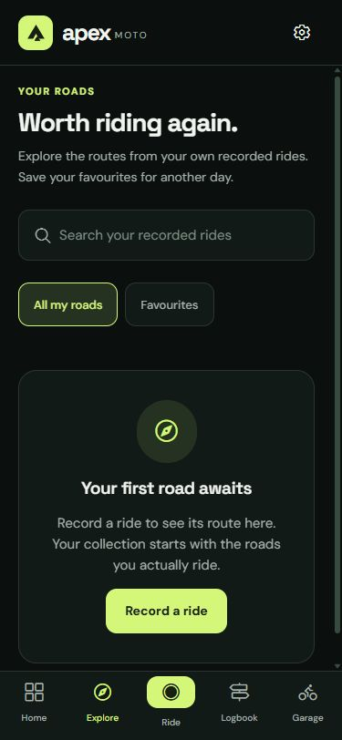
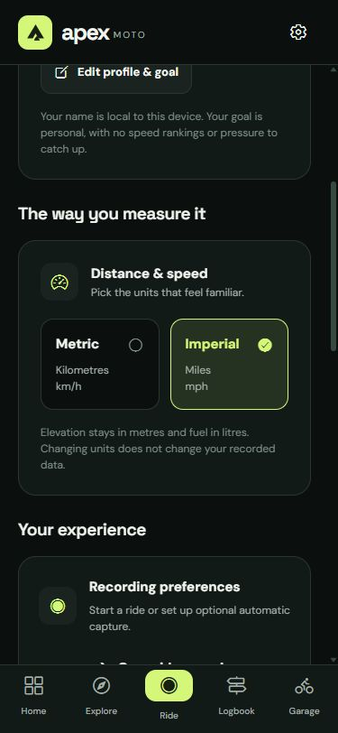

# Apex Moto

**Public source snapshot.** This repository presents the application source, tests and engineering documentation from an independent development project. It starts with a clean publication history; private device recordings and their links are excluded. See [publication scope and verification](docs/publication.md).

**Your open road.** A local-first motorcycle companion built with Expo SDK 57, React Native and TypeScript. Record a ride, replay the journey and keep track of your motorcycle's care.

The engineering focus is reliable capture state, GPS-derived metrics, app-local persistence and privacy controls for exported routes. Pure domain logic is separated from native recording and storage adapters, with regression tests and documented release checks. The current distributable is an Android test release; iOS source support does not establish an iOS release.

Apex is an independent implementation inspired by Ryval's ride-review presentation and Strava's journal patterns. The [research ledger](docs/research.md) records those references and separates observed behavior from publisher claims.

## Android test build and current scope

[Historical Android APK — v1.0.0, build 5](https://expo.dev/artifacts/eas/UGNY96V_dMev3rHSRR2G7D6oPZZWS2YPBC1OWu8wuE8.apk) · [Historical build and device-test guide](docs/release.md)

This externally hosted binary predates the public source snapshot. It was not rebuilt or audited for this publication and is not a new showcase release. Earlier development verification is documented as historical evidence; physical GPS/background/battery and device-specific checks remain necessary before a store release. iPhone distribution requires a separately signed iOS build and Apple provisioning.

- Manual GPS recording, pause/resume, saved drafts and native opt-in automatic capture.
- Ride replay, speed/elevation charts and calibrated mounted-phone lean estimates when available.
- Personal logbook with favourites, notes, motorcycle assignment and weekly distance goals.
- Explore your own recorded roads, with search, favourites and bounded route previews.
- Motorcycle profiles, odometer, editable service/fuel history and entry deletion.
- Endpoint-protected GPX export and PNG/SVG ride postcards.
- Metric/imperial preferences and local data controls.

New installations start with an empty logbook and garage. Import is deferred beyond v1; there is no account backend or cloud sync. Updates within the same installation preserve stored rides and edited motorcycles. Browser/Expo Go storage does not transfer automatically into a standalone installation.

## Current interface

Browser captures at 375 × 812 of the current personal-roads Explore and unit controls. These show layout, not native GPS or battery performance.

| Personal roads | Stable unit controls |
| --- | --- |
|  |  |

## Develop and verify

Use Node.js and npm. Development checks use Node 24 on Windows; GitHub CI uses Node 22 on Ubuntu.

```sh
npm ci
npm run web -- --localhost
npm run check
npx expo-doctor
npm run build
npm run build:native
```

`check` runs TypeScript, lint and domain/adapter regressions. Web export goes to `dist/`; native JavaScript/assets go to `dist-native/`. A native export is not an APK/IPA. `postinstall` prepares the same-origin MapLibre web worker.

For a standalone Android APK:

```sh
npx eas-cli@latest build --platform android --profile preview
```

The configuration retains the original EAS project identity for provenance. Cloud builds require the project owner’s access; contributors should configure their own EAS project and signing credentials before attempting a build. Read the matching [Expo SDK docs](https://docs.expo.dev/versions/v57.0.0/) before API changes; install native dependencies with `npx expo install`. Generated native folders are not hand-maintained.

## Maps, data and scope

Native and web maps use MapLibre and OpenFreeMap, with no map API key required. Basemaps need connectivity; an unavailable map falls back to the stored route outline. Explore contains only recorded personal routes; the sample catalogue is retired. v1 does not provide turn-by-turn directions, live hazards or offline map packs.

Ride and garage records stay in app-local storage. There is no account backend, cloud recovery or social feed. Export important rides before uninstalling. Map providers receive viewport requests, and explicit sharing sends data to the destination you choose. Endpoint protection reduces exposure but is not anonymisation. Lean is a phone estimate, not a motorcycle instrument. Physical-device GPS/background/battery checks remain necessary before a store release.

## Documentation

- [Sanitized device-review summary — findings and retest criteria](docs/audits/2026-10-16-device-video-review.md)
- [Requirements and scope](docs/PRD.md)
- [Architecture and data flow](docs/architecture.md)
- [SDLC, acceptance gates and risks](docs/SDLC.md)
- [Builds and device test checklist](docs/release.md)
- [Privacy and deletion](docs/privacy.md)
- [Dependency security review](docs/security.md)
- [Deferred import decision](docs/data-imports.md)

`src/app` contains Expo Router screens; `components` reusable UI/maps; `domain` pure metrics/capture/export logic; `services` recording/storage/sharing adapters; `tests` synthetic fixtures and regression tests. Legacy catalogue source data is not imported into the app bundle. Source licensing is in [LICENSE](LICENSE); third-party code and map attribution retain their own terms. Apex is not affiliated with Ryval or Strava.
