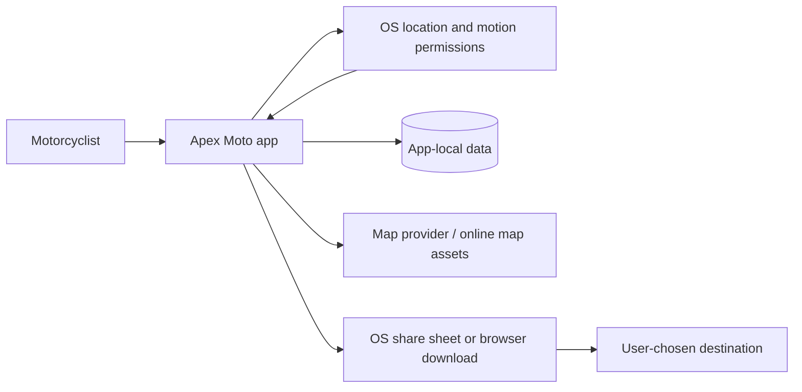
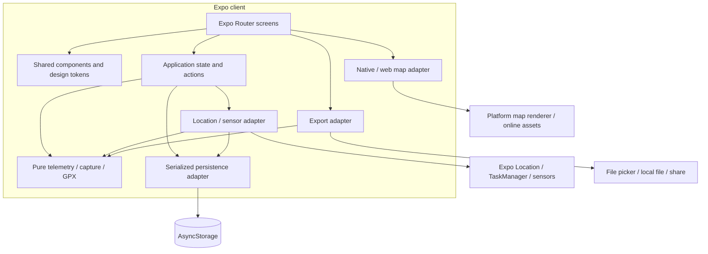
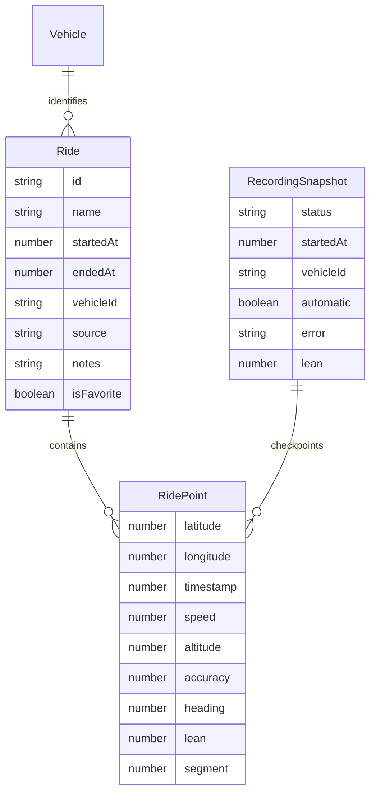
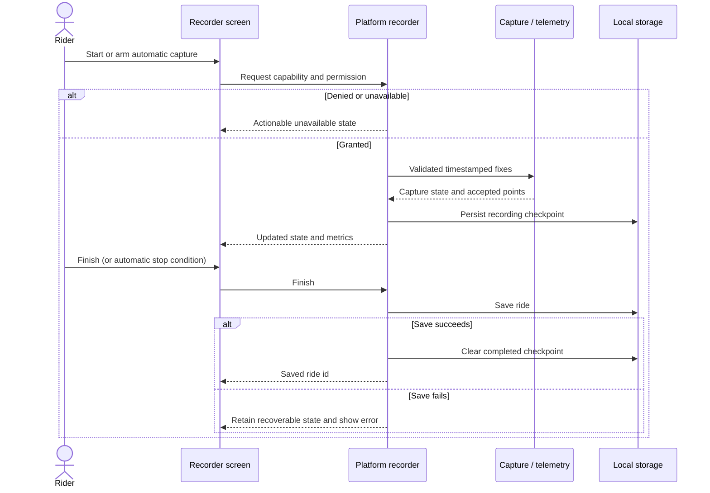

# Architecture and technical decisions

Apex Moto is a local-first Expo SDK 57 / React Native application written in TypeScript. Expo Router owns navigation under `src/app/`; domain calculations and services live outside routes. Android and iOS share the product model; browser preview uses platform adapters. There is no application backend, account service or social API.

The SDK baseline was read from `package.json` and checked against the [SDK 57 reference](https://docs.expo.dev/versions/v57.0.0/), [Expo docs index](https://docs.expo.dev/llms.txt) and [Router documentation](https://docs.expo.dev/router/introduction/). Use those versioned sources when changing native behavior.

## System context

The sharing arrow is an explicit user action. A map provider is a separate network boundary even when the app has no backend. Location storage should not be described as entirely network-free merely because rides are local.

## Containers and responsibilities

| Area                                       | Responsibility / invariant                                                                                                                                                                            |
| ------------------------------------------ | ----------------------------------------------------------------------------------------------------------------------------------------------------------------------------------------------------- |
| `src/domain/ride.ts`                       | WGS84 points; filtering, distance and summary calculations; privacy trim/zone splitting; bounded render-only `thinPoints` sampling. Pure functions do not mutate caller data.                         |
| `src/domain/display.ts`                    | Bounded speed-coloured geometry and time-proportional telemetry chart samples; preserve gaps and missing values.                                                                                      |
| `src/domain/capture.ts`                    | Decide transitions using explicit sample timestamps; separate detection policy from OS callbacks.                                                                                                     |
| `src/domain/gpx.ts`                        | Parse/serialize timed track interchange, preserve segment boundaries, validate coordinates and bounds.                                                                                                |
| `src/services/storage.ts`                  | Serialize local mutations; 256-point chunk journals with a small metadata head; preserve unreadable data.                                                                                             |
| `src/services/storage-types.ts`            | Recorder snapshot contract shared by foreground UI and background adapter.                                                                                                                            |
| `src/services/recording.ts` / `.web.ts`    | Request contextual permissions, own subscriptions/tasks and clean up observers. Surface failures to callers.                                                                                          |
| `src/state/AppContext.tsx`                 | Preferences, real local ride list and durable user actions. No demo mode or sample ride injection. |
| `src/components/RouteMap.tsx` / `.web.tsx` | Native MapLibre React Native v11 and web MapLibre GL; both use OpenFreeMap's labelled Liberty style with route-outline fallback. |
| `src/services/files.ts`                    | Endpoint-protected GPX and PNG/SVG postcard export through download/share adapters. Web PNG uses a local SVG/canvas; native PNG captures the preview with view-shot. |
| Route screens                              | Compose views and actions; avoid embedding telemetry math or storage formats.                                                                                                                         |

## Data model

Coordinates use decimal degrees, timestamps epoch milliseconds, speed metres/second and altitude metres. Missing sensor values are `null`. `source` retains GPS/import/demo values for storage compatibility. The app hides legacy demo records and creates only GPS rides. Previously saved imports remain readable. Segments prevent connecting points across pauses and missing telemetry. Vehicle, saved-route and settings records remain separate from track points. The storage namespace is `@apexmoto/v1/`; future namespace changes require a migration.

Point journals write chunks before committing their metadata head. Recording updates write only the current 256-point tail; saved ride edits use a fresh generation. A manual ride pauses at 50,000 fixes and automatic capture rolls over at its capacity. These bounds reduce individual storage-value size; they do not provide unlimited storage or prove crash safety on every device. Android storage capacity is configured through the project's Expo config plugin.

## Domain policy

The independent automatic-capture reducer uses `disabled → armed → candidate → recording → parked`. Defaults require at least 15 km/h for 15 seconds to start, then at most 3 km/h for 180 seconds to finish. Rides below 500 metres are discarded; pre-roll is bounded to 10 seconds/30 samples. A 50,000-point capacity emits a finish/discard event and rearms. These are inspectable heuristics, not recovered Ryval internals; slow trips and stops can be classified incorrectly.

The ride filter rejects invalid coordinates, non-increasing timestamps, accuracy above 50 metres and speeds/jumps above 250 km/h. Gaps over 30 seconds become separate segments. Small stationary drift is suppressed; elevation gains use a 3-metre threshold. Corner count and smoothness are heuristic summaries, not safety scores. Summary duration includes stopped time, while average speed uses moving time.

Import is deferred beyond v1: no picker, preview, account connection or import button ships. The unused parsers remain covered by regression tests for future work and GPX export round-trips. The retained GPX parser is deliberately limited to timed `trk`/`trkseg` tracks with at least two usable points. Untimed route geometry does not become an invented activity. The retained parser rejects DTDs/custom entities, limits nesting/text/tags, and caps input at 10,000,000 characters and 50,000 points. Imported extension telemetry is user-supplied, not authenticated sensor evidence.

The same bounded XML reader also supports one TCX `Activity` with `Lap/Track/Trackpoint` data. It recognizes timestamp, position, altitude and ActivityExtension speed, ignores health fields and provider summary totals, and splits around GPS-less samples. `importFormat` and `importWarnings` are optional metadata for compatibility with previously saved rides. The former `RideImport` component and file-picker dependency have been removed. Duplicate detection is retained as an unused domain helper. No Google Health OAuth/API connection is deployed; see [integration feasibility and current provider access constraints](data-imports.md).

The native recorder requests balanced accuracy at a 10-second interval while automatically armed, then high accuracy for candidate/recording states. The requested cadence is not an OS delivery guarantee, and battery improvement has not been measured. Mounted-phone lean calibration requires a stationary, accurate fix and stable portrait sensor samples; stale sensor data becomes unavailable. The baseline is not restored across process restarts. The web adapter requires HTTPS/localhost and deliberately pauses when the tab becomes hidden; background capture and mount calibration are unavailable on web.

## Recording and saving

This is the required lifecycle contract; adapter/device tests must establish crash recovery and native background behavior. Expo requires top-level task definition for background location, appropriate permissions and native configuration. User termination and OS scheduling can interrupt delivery. [SDK 57 location](https://docs.expo.dev/versions/v57.0.0/sdk/location/) [TaskManager](https://docs.expo.dev/versions/v57.0.0/sdk/task-manager/)

## Decisions and consequences

| Decision                                  | Reason                                                     | Tradeoff / follow-up                                                                    |
| ----------------------------------------- | ---------------------------------------------------------- | --------------------------------------------------------------------------------------- |
| One TypeScript client + platform adapters | Shared behavior and faster consistency fixes.              | Native build/device validation remains necessary.                                       |
| Pure domain functions                     | Deterministic fixtures and easier numerical review.        | Filter thresholds are product assumptions, not certified instrument accuracy.           |
| Local persistence without login           | Useful immediately and works without a backend.            | Device loss/uninstall can lose data; no automatic cloud recovery.                       |
| AsyncStorage chunk journals               | Local model with serialized writes and bounded value size. | Not encrypted by the app; large histories need profiling and future database migration. |
| Personal recorded routes only | Explore the rider's actual road history. | No recommendation network; an honest empty state before the first ride. |
| User-triggered GPX sharing                | Portable data and explicit transfer.                       | Shared copies cannot be recalled; exported locations may identify a rider.              |
| Native configuration via Expo plugins     | Keep generated projects reproducible.                      | Changes to native config need a new binary.                                             |

For long tracks, simplify only render geometry, memoize summaries and avoid rebuilding every route path on every sample. Keep the original accepted trace for exports. Profile on release builds; smooth browser behavior alone is insufficient evidence for 60 Hz on devices.

Display helpers cap speed-coloured paths at 600 vertices including duplicated colour boundaries, and telemetry charts at 160 samples. These are display approximations; full accepted points still determine statistics and exports. Speed colours describe ranges, not road safety or riding quality, and missing telemetry breaks chart lines rather than inventing values.

Bundled route shapes originate from development-time OSRM requests over OSM data. Synthetic ride generation has been removed. Native and web maps use MapLibre with OpenFreeMap: no Google/Apple map key is required. Online basemaps remain separate from stored route geometry. Native map load failure keeps the route outline visible and offers retry. A tilted camera is not a 3D terrain renderer. Expo Go gets an outline because its binary does not contain MapLibre; standalone builds include the native module. [MapLibre Expo setup](https://maplibre.org/maplibre-react-native/docs/setup/expo/)

`scripts/prepare-web.mjs` copies MapLibre's module worker, shared module and license from the installed package to `public/vendor/maplibre/` during `postinstall`. The browser loads these same-origin assets; a web host must serve that path and rewrite application routes to `index.html`. Preserve provider attribution controls.

Future cloud work must introduce a versioned API, authentication, per-object authorization, explicit sharing scopes, retention/deletion and conflict resolution. Do not route raw location through a generic analytics pipeline.
