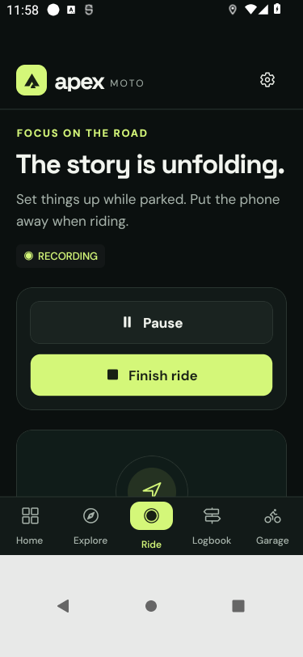

# Device-video audit remediation

This is a historical development record. Its earlier test results were not rerun for this public source snapshot; private Actions links have been omitted.

This follow-up implements fixes from the [original video audit](2026-10-16-device-video-review.md). That audit remains a record of the earlier build. Source changes, automated checks and browser checks are not substitutes for retesting the signed APK on the affected Realme Narzo 30 / Android 12.

## Period selector and units

**This week** includes rides whose start time falls between local Monday 00:00 and the next Monday 00:00. **All time** includes every saved ride. The selector changes distance, moving time and ride count. The latest ride and weekly goal remain independent. Both periods can correctly show identical totals when all saved rides are from the current week. Labels, selected styling and explanatory text now make this explicit; weekly-boundary and small-distance tests cover the calculation.

The user's clarification is preserved: the period selector was confusing, not flickering. The metric/imperial flicker came from replacing a multi-line explanation with a short saving message. The explanation and check-icon space now stay fixed during saving. Unit cards wrap at narrow widths or large font sizes.

## Changes by finding

| Audit ID | Change | Verification / remaining check |
| --- | --- | --- |
| V01 | Calibration ignores missing/non-finite/stale orientation and acceleration samples. A readable sensor error leaves GPS active. | Adapter regressions cover partial rotation and valid calibration. Retest physical phone motion sensor. |
| V02 | Persist explicit automatic-capture intent before opening Android Settings; recover it after process recreation only if permission is granted and intent is less than 15 minutes old. Clear failed/expired intent. Roll back failed writes without orphaning GPS. | Regressions cover permission interruption, denial, expiry and storage failure. OEM permission flow still needs retest. |
| V03 | Remove bundled route catalogue and Home scenic promotion from the shipped app. Explore now displays only the user's recorded routes, with favourites, search and a useful empty state. | Clean browser installation contains no sample routes/rides/bike. Only known retired catalogue bookmark IDs are migrated; personal rides remain intact. |
| V04 | Keep a dark branded splash until fonts and app storage are ready. Restore the last screen after a cold launcher restart; explicit deep links take precedence. | Mitigation, not a proven diagnosis. The video cannot establish whether Android killed the process, native maps failed, or another fault occurred. Physical Maps-return and native-log retest remains required. |
| V05 | Move ride-edit dialogs outside the scrolling page and allow handled keyboard taps. | Native keyboard-open Save still needs physical retest. |
| V06 | Add edit and confirmed deletion for service/fuel entries; recompute totals without lowering current odometer or rewriting reminders. | Browser flow: 10 L / INR 1,000 corrected to 8 L / INR 800; service correction preserves 10,000 km current reading. |
| V07 | Do not prefill a past-due reminder as the next service reading in a new service form. | Browser: 10,000 km bike with 3,000 km overdue reminder opens a valid blank next-service field and saves once. |
| V08 | Require review and explicit confirmation for a fill above 40 litres. | Browser: 100 L presents review; correcting to 10 L returns to normal save. This is a sanity check, not a motorcycle-specific tank limit. |
| V09 | Retire sample catalogue and its misleading endpoint-only navigation flow from normal navigation. | No claim that Google Maps follows the old catalogue geometry. v1 is a recorder/reviewer, not turn-by-turn navigation. |
| V10 | Fallback route outline uses the same minimum geographic extent as the native map. | Short tracks no longer auto-fill the canvas at an exaggerated scale. Original GPS points are preserved. |
| V11 | Separate camera pitch from bounds fitting. Add explicit Fit route control. | Camera API checked against installed MapLibre source; native zoom/tilt retest required. |
| V12 | Put Start/Pause/Finish before the map. Hide idle telemetry; automatic setup follows the primary controls. | Mobile preview checks; signed native smoke checks recording controls. |
| V13 | Explain armed waiting state and offer an explicit manual-start action that turns automatic capture off first. | State adapter tests preserve active routes; physical manual/automatic handoff retest required. |
| V14 | Replay defaults to 1×, offers 1/2/4/8/16/32/64×; short rides use 5-second skips. | Source/type checks; replay remains a review feature for use while parked. |
| V15 | Add telemetry range/unit, elapsed-time endpoints and playhead cursor. Hide unavailable lean needle. | Missing lean remains unavailable, not measured zero. |
| V16 | Preserve one decimal for small distances and label moving time accurately. | Regression: approximately 0.2 km remains 0.2 km; week/all-time aggregation tested. |
| V17 | Latest-ride bookmark now toggles the stored favourite state. | Shares the same persisted state as Logbook and Explore. |
| V18 | Show Unassigned and an empty-garage explanation in ride editing. | Saving notes/name does not require inventing a motorcycle. |
| V19 | Show one inline recording error, shorten and allow dismissal of general messages, and place messages in layout above navigation. | No absolute toast overlay covering actions. |
| V20 | Responsive primary buttons and equal-stretch statistic cards; compact estimated-minute label; stable, readable unit cards; shorter automatic heading. | 375 px browser review. Legacy route screen retained only for safe handling of old links, with no bundled catalogue. |
| V21 | Use a lighter labelled basemap for geographic context while retaining dark app chrome. | Online map loading/offline fallback still needs physical coverage. |
| V22 | Show native application version and build number in Settings. | Web explicitly says WEB PREVIEW. APK metadata checked during release. |

Explore initially renders 12 personal routes and samples each preview to at most 200 vertices. Additional routes load on request. No new import surface or fabricated activity data is added.

## Release checks

- `npm run check`: TypeScript, Expo lint, 57 domain tests and 20 recording/storage adapter tests.
- `npx expo-doctor`: 21 checks.
- Android/iOS JavaScript export and signed Android EAS preview build.
- Isolated Android emulator smoke test: first permission, GPS delivery, background survival, pause/resume/save, unit-card bounds, period explanations and personal Explore.
- Physical retest remains necessary for Realme sensor calibration, Android Settings process recreation, Maps return, keyboard-first Save, large system fonts and a longer outdoor/screen-locked ride.

Build 5 passed the signed Android 12 regression (historical development record), including keyboard-open first Save, favourites, replay speed, last-screen restoration, units bounds, period explanations and personal Explore. Signature, binary checksum and empty crash buffer were checked against the downloaded artifact. The [build record](../releases/android-v1-build5.json) retains exact provenance; [release instructions](../release.md) list remaining physical checks.

This is an isolated emulator using synthetic GPS, not seeded data shipped to users. Private screen recordings and their GPS content are not committed.
